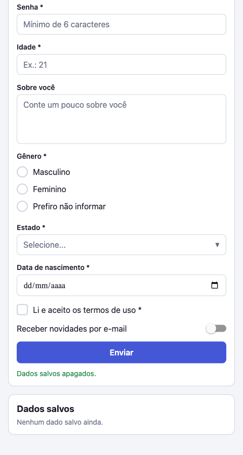
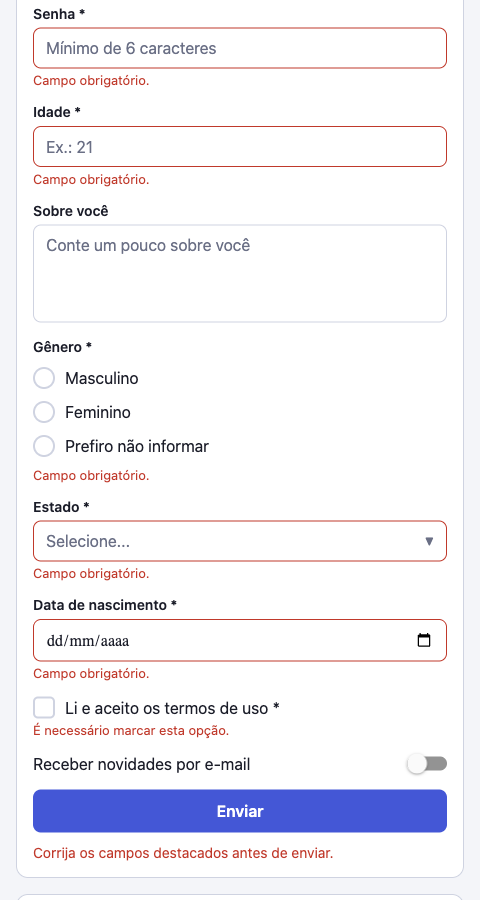

# CP03: Formulários dinâmicos a partir de JSON

Aplicativo em React Native (Expo SDK 55) e TypeScript que monta um formulário a partir de uma configuração. O título, os campos, os rótulos, os tipos, as opções e a obrigatoriedade vêm do objeto de configuração. A tela não declara nenhum campo individualmente. As respostas são validadas, exibidas após o envio e guardadas localmente com AsyncStorage.

## Integrantes

- Ana Luiza Santana da Rocha, RM561194
- Evandro Yuji Kaibara de Oliveira, RM559274
- Guilherme Rodrigues Leite, RM560131
- Luís Filipe Crivellaro, RM560877
- Pedro Henrique Batista Bergamin, RM559443

## Tecnologias

- React Native 0.83 com Expo SDK 55
- TypeScript (modo `strict`, sem `any`)
- AsyncStorage (`@react-native-async-storage/async-storage`)
- `@react-native-community/datetimepicker` no Android e no iOS
- `react-native-web` na versão Web
- Jest com `jest-expo` nos testes de validação

## Como executar

É preciso ter Node.js 20 ou superior.

```bash
npm install
npx expo start          # abre o menu para Android, iOS ou Web
npx expo start --web    # abre direto na Web
```

Outros comandos:

```bash
npm test                # testes de validação
npm run typecheck       # verificação de tipos
```

Para Android e iOS, use o app Expo Go ou um emulador ou simulador, escolhido no menu que o `npx expo start` exibe.

## Funcionamento

1. `src/config/formConfig.ts` define o título e o array `fields`.
2. `FieldRenderer` percorre `fields` e escolhe o componente pelo `type`.
3. `useDynamicForm` controla valores e erros. Ao enviar, valida todos os campos e só então salva.
4. `useSubmissionStorage` carrega o último envio ao abrir o app, salva após um envio válido e remove quando o usuário pede.
5. O painel "Dados salvos" lista os campos na ordem da configuração, com o rótulo de cada opção.

### Tipos de campo suportados

| Tipo | Componente | Observação |
|---|---|---|
| `text` | `TextField` | |
| `email` | `TextField` | valida o formato |
| `password` | `TextField` | caracteres ocultos, mínimo de 6; exibição mascarada |
| `number` | `TextField` | teclado numérico, valida o número |
| `multiline` / `textarea` | `TextField` | várias linhas |
| `select` / `combo` | `SelectField` | dropdown em linha, igual em todas as plataformas |
| `radio` | `RadioField` | opções vindas de `options` |
| `checkbox` | `CheckboxField` | com `required`, exige marcação |
| `switch` | `SwitchField` | desligado é uma resposta válida e nunca bloqueia o envio |
| `date` | `DateField` / `DateField.web.tsx` | seletor nativo no Android e no iOS; `<input type="date">` na Web |

### Regras de validação

- Com `required: true`, texto, seleção e data precisam ser preenchidos. Campos de seleção aceitam apenas uma opção da lista.
- Um `checkbox` obrigatório precisa estar marcado.
- Um `switch` nunca bloqueia o envio, porque `false` é uma resposta.
- Formatos (e-mail, número, data e senha) são verificados sempre que houver valor, inclusive em campo opcional.
- Enquanto houver erro, o envio fica bloqueado e cada campo mostra a sua mensagem.

### Plataformas

Só um ponto depende da plataforma: `DateField.tsx` usa `@react-native-community/datetimepicker` no Android e no iOS, e `DateField.web.tsx` usa o input de data do navegador. O Expo escolhe o arquivo sozinho. Os demais componentes usam apenas React Native, com `StyleSheet` e Flexbox, e por isso funcionam igual nas três plataformas.

## Prints

Versão Web, testada no navegador com viewport de 480 px.

| Formulário vazio | Validação | Resultado salvo |
|---|---|---|
|  |  |  |

## Estrutura de pastas

```text
App.tsx                         ponto de entrada da tela
index.ts                        registro do componente raiz (Expo)
src/
  config/formConfig.ts          configuração JSON-like do formulário
  types/form.ts                 tipos de campo, valores, erros e submissão
  components/
    FieldRenderer.tsx           escolhe o componente pelo type
    FieldWrapper.tsx            rótulo, erro e estilo compartilhado
    SubmissionResult.tsx        painel com o último envio salvo
    fields/                     um componente por família de controle
      TextField.tsx             text, email, password, number, multiline
      SelectField.tsx           select / combo
      RadioField.tsx            radio
      CheckboxField.tsx         checkbox
      SwitchField.tsx           switch
      DateField.tsx             date (Android/iOS)
      DateField.web.tsx         date (Web)
  hooks/
    useDynamicForm.ts           valores, erros e envio do formulário
    useSubmissionStorage.ts     carregar, salvar e limpar o envio
  screens/FormScreen.tsx        tela principal
  services/storage.ts           acesso ao AsyncStorage
  utils/
    validation.ts               regras de validação e formatação
    validation.test.ts          testes das regras
    date.ts                     conversão de datas locais
  theme.ts                      cores e espaçamentos
docs/screenshots/               prints usados neste README
```
